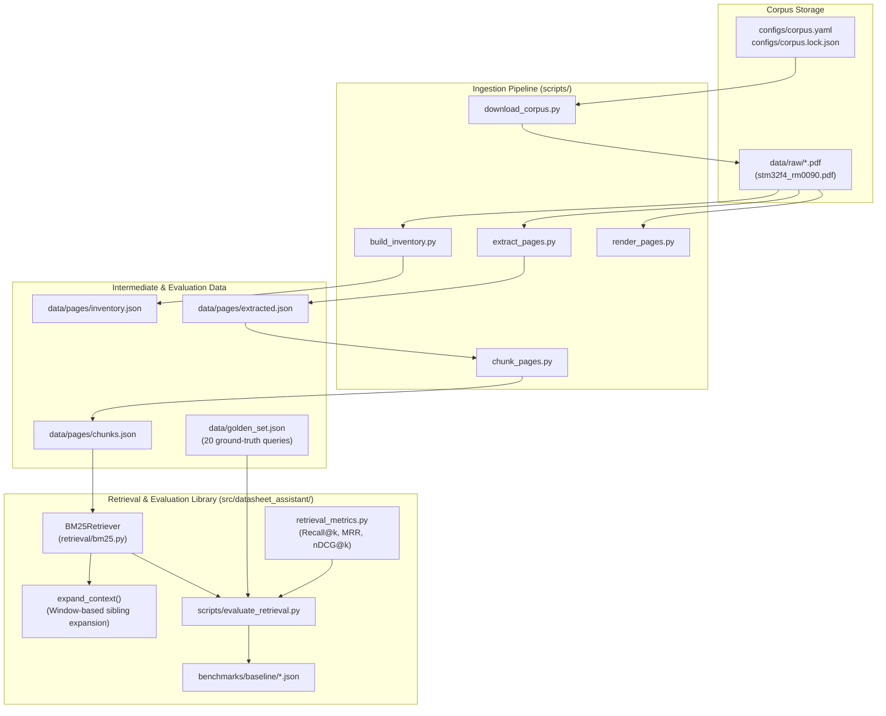

# Datasheet Assistant

A specialized retrieval and ingestion pipeline for microcontroller reference manuals and datasheets (STM32 & ESP32), designed as the retrieval foundation for a technical datasheet RAG assistant.

---

## 1. Overview & Problem Statement

Embedded systems engineering relies heavily on massive technical documentation:
- Vendor reference manuals often exceed 1,000 to 2,000 pages (e.g., STM32F4 RM0090 is 1,741 pages).
- Information is dense, highly structured, and multi-modal, containing register maps, bitfield definitions, memory-mapped addresses, block diagrams, and electrical characteristics.
- Standard naive RAG chunking (e.g., arbitrary 500-token sliding windows crossing page boundaries) breaks critical context:
  - Register field tables are split across chunks without their parent register names.
  - Page citations become ambiguous or incorrect.
  - Standard text tokenizers strip underscore characters (`_`), mutilating register identifiers such as `GPIOx_MODER` or `USART_BRR` into disconnected word fragments.

**Datasheet Assistant** addresses these ingestion and retrieval hurdles through a deterministic, page-bounded, structure-aware pipeline paired with identifier-preserving BM25 keyword retrieval, page-local context expansion, and reproducible benchmark metrics.

---

## 2. Project Goals

- **Accurate Ingestion**: Extract technical PDF text while strictly preserving page boundaries for 100% exact page-level citations.
- **Structure-Aware Chunking**: Split text at numbered section headings and figure/table captions, preventing orphan register definitions.
- **Identifier-Preserving Tokenization**: Keep register acronyms, bus names, and peripheral identifiers (e.g., `GPIOx_BSRR`, `DMA_MEM2`) intact.
- **Context Expansion**: Retrieve top-scoring chunks and deterministically re-attach sibling chunks on the same physical page before downstream consumption.
- **Rigorous Evaluation**: Track retrieval precision, ranking quality, and query latency across an explicit golden benchmark dataset.

---

## 3. Features Implemented vs. Planned

| Status | Feature | Details |
|---|---|---|
| **Implemented** | Automated Corpus Management | Streaming PDF download with SHA-256 validation and atomic lockfile (`corpus.lock.json`). |
| **Implemented** | Full Document Page Inventory | Full-document structural survey tracking dimensions, text density, embedded images, and preview per page. |
| **Implemented** | Targeted Text Extraction | PyMuPDF-based page extraction supporting discrete page lists and ranges (`lo-hi`). |
| **Implemented** | Page-Bounded Structure Chunking | `page-bounded-structure-aware-v1` algorithm with greedy packing, word-boundary protection, and heading inheritance. |
| **Implemented** | Identifier-Preserving BM25 | `rank-bm25` (BM25Okapi) with a custom alphanumeric/underscore tokenizer (`[a-zA-Z0-9_]+`). |
| **Implemented** | Context Expansion | Sibling window expansion (`expand_context()`) preserving retrieval order across pages while sorting chunks chronologically within each page. |
| **Implemented** | Retrieval Evaluation Suite | Implementation of Recall@k, MRR, nDCG@k, and latency percentiles (mean & p95). |
| **Implemented** | Comprehensive Test Suite | 112 passing pytest cases covering download validation, edge cases, chunk invariants, and metrics. |
| **Planned** | Full Manual Ingestion | Ingesting the complete 1,741 pages of STM32F4 RM0090 and ESP32 manuals beyond the current 5-page sample. |
| **Planned** | Dense / Hybrid Semantic Search | Dense vector embeddings (e.g., BGE, ColBERT, or domain-adapted embeddings) combined with BM25 via Reciprocal Rank Fusion (RRF). |
| **Planned** | Cross-Encoder Reranking | Reranking top-k candidate pools with a specialized cross-encoder. |
| **Planned** | LLM Synthesis & Grounded Answers | Answer generation with citations using LLM APIs (e.g., Gemini API configured in `.env.example`). |
| **Planned** | Interactive UI / CLI | User-facing terminal interface or web app for interactive datasheet Q&A. |

---

## 4. Architecture

The current implementation encompasses the complete ingestion, chunking, retrieval, and evaluation pipeline:



---

## 5. Pipeline Details

1. **Corpus Ingestion (`scripts/download_corpus.py`)**:
   Reads `configs/corpus.yaml`, streams vendor PDFs, verifies HTTP headers and `%PDF-` file magic bytes, computes SHA-256 hashes, and records size and hash in `configs/corpus.lock.json`. Unfinished downloads (`.part`) are purged on error.

2. **Inventory Analysis (`scripts/build_inventory.py`)**:
   Scans entire documents (1,741 pages for RM0090) and logs page count, dimensions, text character density, image counts, and text previews into `data/pages/inventory.json`.

3. **Page Extraction (`scripts/extract_pages.py`)**:
   Extracts text only from pages specified in `corpus.yaml` (e.g., `pages: [60, 269, 306, 871, 963]`). Produces `data/pages/extracted.json` containing verbatim strings and page character counts.

4. **Structure-Aware Chunking (`scripts/chunk_pages.py`)**:
   Applies `page-bounded-structure-aware-v1`:
   - Never spans across page boundaries: `chunk["page_number"]` is strictly accurate.
   - Detects section headings (`8.1`, `8.3 GPIO functional description`) and captions (`Figure N.`, `Table N.`).
   - Packs text greedily up to `max_chars - overlap` (default 1000 chars, 150 overlap).
   - Generates deterministic IDs: `{doc_id}-p{page_number:04d}-c{chunk_index:03d}` (e.g., `stm32f4_rm0090-p0269-c000`).

5. **BM25 Keyword Retrieval (`src/datasheet_assistant/retrieval/bm25.py`)**:
   Initializes `BM25Okapi` over tokenized chunks. The custom tokenizer treats `[a-zA-Z0-9_]+` as words, ensuring register names (e.g., `GPIOx_MODER`, `SPI_CR1`) are indexed as unified tokens.

6. **Context Expansion (`BM25Retriever.expand_context()`)**:
   Expands a list of retrieved chunks by pulling adjacent chunks from the same document page within a parameterized `window`. Neighboring chunks have `expanded: True` and `score: 0.0`. Chunks are organized by document page in retrieval order, and sorted in natural reading sequence within each page.

7. **Evaluation Pipeline (`scripts/evaluate_retrieval.py`)**:
   Runs 20 golden queries against the index, repeats each query 20 times to measure steady-state latencies, and computes ranking metrics against annotated relevant chunk IDs.

---

## 6. Repository Structure

```text
datasheet-assistant/
├── .env.example                               # Environment template (GEMINI_API_KEY)
├── .gitignore                                 # Git rules excluding data/raw, caches, eggs
├── pyproject.toml                             # Package configuration (PEP 517/621)
├── requirements.txt                           # Direct dependencies
├── configs/
│   ├── corpus.yaml                            # Document URLs and targeted page numbers
│   └── corpus.lock.json                       # SHA-256 and byte size integrity record
├── data/
│   ├── golden_set.json                        # 20 hand-curated questions with relevance labels
│   ├── pages/                                 # Intermediate pipeline artifacts (gitignored)
│   │   ├── extracted.json                     # Verbatim extracted page text
│   │   ├── chunks.json                        # Chunks with offsets, headings, and hashes
│   │   └── inventory.json                     # Metadata survey of 1,741 document pages
│   └── raw/                                   # Downloaded vendor PDFs (gitignored)
│       └── stm32f4_rm0090.pdf                 # 21.4 MB STM32F4 reference manual
├── benchmarks/
│   └── baseline/
│       ├── bm25_initial.json                  # Current baseline (evaluated Oct 21, 2026)
│       └── bm25_before_label_review.json      # Earlier baseline prior to label review
├── scripts/
│   ├── download_corpus.py                     # Streaming corpus downloader and hasher
│   ├── build_inventory.py                     # PDF page metadata cataloger
│   ├── extract_pages.py                       # Targeted page text extractor
│   ├── chunk_pages.py                         # Structure-aware page chunker
│   ├── render_pages.py                        # High-resolution page renderer (PNG)
│   ├── evaluate_retrieval.py                  # Benchmark runner against golden_set.json
│   ├── test_retrieval.py                      # Quick manual retrieval demonstration
│   ├── inspect_retrieval.py                   # Verbose top-5 inspection script
│   ├── inspect_evaluation_failures.py         # Failure inspection for low-recall queries
│   ├── inspect_inventory.py                   # Schema printer for inventory.json
│   └── inspect_inventory_stats.py             # Density & image statistics across PDF pages
├── src/
│   └── datasheet_assistant/
│       ├── __init__.py
│       ├── retrieval/
│       │   ├── __init__.py
│       │   └── bm25.py                        # BM25Retriever and expand_context()
│       └── evaluation/
│           ├── __init__.py
│           └── retrieval_metrics.py           # recall_at_k, reciprocal_rank, ndcg_at_k
└── tests/
    ├── test_bm25.py                           # 31 unit tests (retrieval & expansion)
    ├── test_chunk_pages.py                    # 65 tests (chunking invariants, boundary splits)
    ├── test_download_corpus.py                # 8 tests (mocked streaming, network drops)
    └── test_retrieval_metrics.py              # 8 unit tests (metric calculations)
```

---

## 7. Tech Stack

- **Language**: Python 3.11+
- **PDF Extraction & Inspection**: `pymupdf` (MuPDF 1.24+)
- **Lexical Retrieval**: `rank-bm25` (BM25Okapi implementation)
- **Dense Semantic Retrieval**: `sentence-transformers` (`all-MiniLM-L6-v2`, local CPU execution)
- **Hybrid Retrieval**: Reciprocal Rank Fusion (RRF) combining sparse BM25 and dense embeddings
- **Configuration & Serialization**: `pyyaml`, standard library `json`
- **Networking**: `requests` (streaming chunk downloads)
- **Testing**: `pytest` (138 test cases, including full offline mock suites)

---

## 8. Dataset & Corpus Details

### Current Corpus (`configs/corpus.yaml`)
- **Document**: STMicroelectronics RM0090 (STM32F405/415, STM32F407/417, STM32F427/437, STM32F429/439 Reference Manual, Rev 22).
- **Total Document Size**: 1,741 pages (21,385,881 bytes, SHA-256: `f3ff2322...`).
- **Sampled Subset**: 5 selected pages currently chunked into **11 chunks**:
  - Page 60: Memory and system architecture diagram (`1 chunk`).
  - Page 269: GPIO introduction, main features, functional description (`3 chunks`).
  - Page 306: DMA functional description & block diagram (`2 chunks`).
  - Page 871: SPI functional description, NSS pin, block diagram (`3 chunks`).
  - Page 963: USART block diagram and signal descriptions (`2 chunks`).
- *Note on ESP32*: ESP32 datasheets are referenced in `configs/corpus.yaml` as targets, but have URLs set to `null` and are not yet ingested.

### Golden Dataset (`data/golden_set.json`)
Consists of **20 human-labeled technical queries** across 5 categories:
- `diagram` (7 questions)
- `register_lookup` (5 questions)
- `functional_description` (4 questions)
- `signal_lookup` (3 questions)
- `specification` (1 question)

Each entry contains the query string, category, and target `relevant_chunk_ids`.

---

## 9. Retrieval & Evaluation Methodology

### Metrics

1. **Recall@10**:
   Fraction of labeled relevant chunks present within the top 10 returned candidates:
   $$\text{Recall@k} = \frac{|\text{Retrieved}_k \cap \text{Relevant}|}{|\text{Relevant}|}$$

2. **MRR (Mean Reciprocal Rank)**:
   Measures ranking quality of the first hit:
   $$\text{RR} = \frac{1}{\text{rank}_{\text{first\_relevant}}}$$

3. **nDCG@10 (Normalized Discounted Cumulative Gain)**:
   Evaluates full ranking position discount under binary relevance:
   $$\text{DCG@k} = \sum_{i=1}^{k} \frac{2^{\text{rel}_i} - 1}{\log_2(i + 1)}, \quad \text{nDCG@k} = \frac{\text{DCG@k}}{\text{IDCG@k}}$$

4. **Latency Measurement**:
   Each query runs 1 unmeasured warm-up cycle, followed by 20 measured iterations via `time.perf_counter()`. Mean and p95 latencies are recorded in milliseconds.

---

## 10. Baseline Benchmark Results

The table below reports actual benchmark results recorded in [`benchmarks/baseline/bm25_initial.json`](file:///e:/praveen/pro/datasheet-assistant/benchmarks/baseline/bm25_initial.json) (evaluated Oct 21, 2026):

| Metric | Baseline Value | Note |
|---|:---:|---|
| **Evaluated Queries** | 20 | Categorized technical questions |
| **Cutoff ($k$)** | 10 | Evaluated on top-10 retrieved chunks |
| **Mean Recall@10** | **0.900** | 18 of 20 queries achieved 100% recall |
| **Mean MRR** | **0.833** | First relevant hit typically at rank 1 or 2 |
| **Mean nDCG@10** | **0.795** | High ranking concentration near top positions |
| **Mean Query Latency** | **0.221 ms** | Python in-memory BM25 index |
| **p95 Query Latency** | **0.377 ms** | Measured over $20 \times 20 = 400$ search iterations |

### Hybrid Retrieval Comparison (BM25 vs Dense vs Hybrid)

Evaluated in [`benchmarks/hybrid_retrieval_comparison.json`](file:///e:/praveen/pro/datasheet-assistant/benchmarks/hybrid_retrieval_comparison.json) across the 20 golden set queries:

| Strategy | Recall@10 | MRR | nDCG@10 | Mean Query Latency | p95 Query Latency |
|---|:---:|:---:|:---:|:---:|:---:|
| **BM25 (Baseline)** | 0.9000 | 0.8333 | 0.7952 | 0.133 ms | 0.212 ms |
| **Dense (`all-MiniLM-L6-v2`)** | 1.0000 | 0.8583 | 0.8675 | 7.422 ms | 10.231 ms |
| **Hybrid (RRF, $k=60$)** | 0.9750 | **0.8667** | 0.8506 | 7.648 ms | 9.818 ms |

*Note: In the specification category, Dense scored an MRR of 0.3333 while BM25 achieved 1.0000; Hybrid fusion correctly retained the rank-1 position (MRR 1.0000), illustrating the resilience of RRF against individual modality failure modes.*

### Failure Analysis on Underperforming Queries

In the baseline benchmark, 4 questions scored below 1.0 Recall@10:
- **`q005`** (*USART block diagram signals*): Recall@10 = 0.50, nDCG@10 = 0.613
- **`q016`** (*USART receiver/transmitter signals*): Recall@10 = 0.50, nDCG@10 = 0.613
- **`q017`** (*USART block diagram registers*): Recall@10 = 0.50, nDCG@10 = 0.387
- **`q019`** (*USART baud-rate register*): Recall@10 = 0.50, nDCG@10 = 0.613

**Root Cause**: All four queries target the USART documentation and share a miss on chunk `stm32f4_rm0090-p0963-c001`. Because page 963 is divided into two chunks (`c000` containing the header and diagram labels, and `c001` containing functional text), pure keyword overlap preferentially ranks chunks from pages 269 and 871 over `c001`. This highlights the need for hybrid dense retrieval and context expansion.

---

## 11. Limitations & Important Context

> [!WARNING]
> **Corpus Size Limitation**: The current benchmark was conducted over a **sample corpus of 11 chunks across 5 pages**.
> Because top-$k$ is set to 10 in a corpus of 11 chunks, the retriever returns 91% of the entire index for every query.
> While the MRR (0.833) and nDCG@10 (0.795) demonstrate genuine ranking ability among candidates, the Recall@10 metric (0.900) is preliminary and will face significantly harder discrimination once the entire 1,741-page manual is indexed.

---

## 12. Local Setup & Execution Guide

### Prerequisites
- Python 3.11+
- Windows PowerShell (or Linux/macOS bash)

### 1. Environment Setup

```powershell
# Clone or open the repository
cd e:\praveen\pro\datasheet-assistant

# Create virtual environment
python -m venv .venv

# Activate virtual environment (PowerShell)
.\.venv\Scripts\Activate.ps1

# Install package in editable mode along with requirements
pip install -r requirements.txt
pip install -e .
```

### 2. Run Ingestion Pipeline (Step-by-Step)

The repository comes with pre-generated chunk artifacts, but you can reproduce the entire pipeline from scratch:

```powershell
# Step 1: Download or verify corpus PDF and lockfile
python scripts\download_corpus.py

# Step 2: Build full-document structural inventory (optional, analyzes all 1,741 pages)
python scripts\build_inventory.py

# Step 3: Extract text from selected pages specified in corpus.yaml
python scripts\extract_pages.py

# Step 4: Chunk extracted text using structure-aware strategy
python scripts\chunk_pages.py --max-chars 1000 --overlap 150
```

### 3. Run Retrieval & Benchmarks

```powershell
# Execute automated retrieval evaluation against golden_set.json
python scripts\evaluate_retrieval.py

# Inspect failure queries in detail
python scripts\inspect_evaluation_failures.py

# Test manual query retrieval from the CLI
python scripts\test_retrieval.py
```

### 4. Run Test Suite

```powershell
pytest -v
```
All 112 test cases should pass without failures.

---

## 13. Example Usage in Python

```python
from pathlib import Path
from datasheet_assistant.retrieval.bm25 import BM25Retriever

# Initialize retriever with chunk artifact
chunks_file = Path("data/pages/chunks.json")
retriever = BM25Retriever(chunks_file)

# Search top-3 chunks
query = "Which registers configure an STM32 GPIO port?"
results = retriever.search(query, top_k=3)

for rank, item in enumerate(results, start=1):
    print(f"[{rank}] {item['chunk_id']} (Page {item['page_number']}) - Score: {item['score']:.3f}")
    print(f"Section: {item['section_heading']}")
    print(item['text'][:180], "...\n")

# Apply context expansion to retrieve page sibling chunks
expanded_results = retriever.expand_context(results, window=1)
print(f"Original hits: {len(results)}, Expanded context blocks: {len(expanded_results)}")
```

---

## 14. Roadmap

- [x] Ingestion, structural chunking, and metadata extraction.
- [x] Register-preserving BM25 search.
- [x] Sibling window context expansion.
- [x] Golden evaluation set (20 queries) & automated metric reporting.
- [x] Dense embedding retrieval (`sentence-transformers/all-MiniLM-L6-v2` locally on CPU).
- [x] Reciprocal Rank Fusion (RRF) for hybrid sparse + dense retrieval.
- [ ] Scale chunking to the entire STM32F4 RM0090 manual (all 1,741 pages).
- [ ] Add ESP32 Technical Reference Manual to corpus ingestion.
- [ ] Integrate LLM grounded answer synthesis (using Gemini 1.5 / 2.0 API).
- [ ] Add interactive CLI / web interface with exact PDF page snippet previews.
